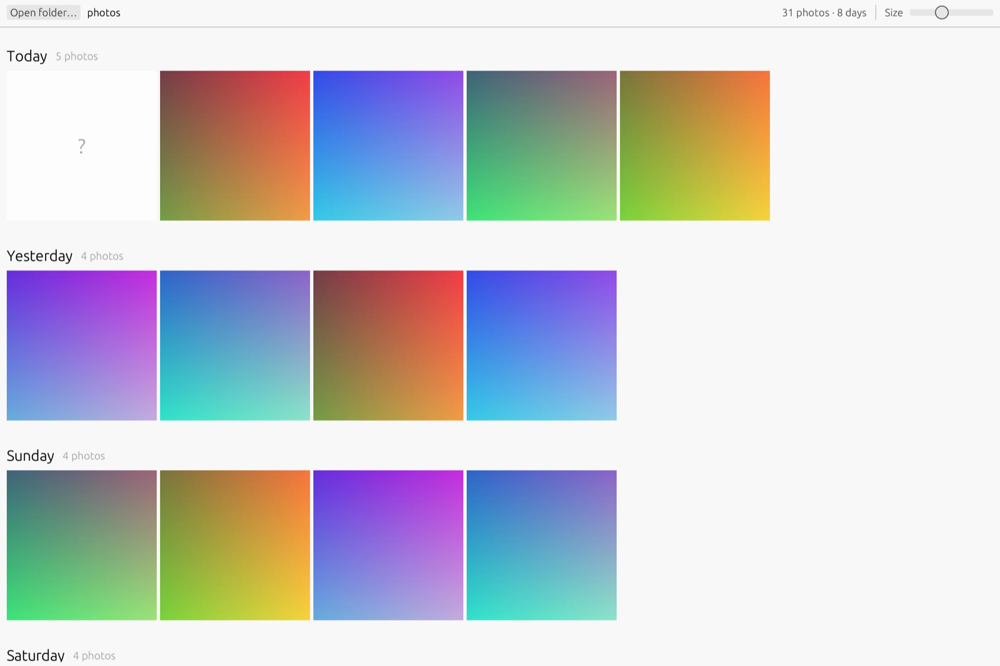

# Banana Photos

An offline photo library written in Rust, laid out like Google Photos. Open a folder and every photo in it (and its sub-folders) is shown by month and day, newest first. Nothing is uploaded anywhere.



## Install

Download from the [latest release](https://github.com/aqibshabbirdev/banana-rs/releases/latest). The AI models (faces, pets, documents, search) are included, and everything runs offline.

**Mac (Apple Silicon, macOS 11 or newer)**

1. Download `BananaPhotos-<version>-arm64.dmg`, open it, and drag **Banana Photos** to **Applications**.
2. The app isn't notarized by Apple, so the first time, right-click it in Applications and choose **Open**, then **Open** again. (Or run `xattr -cr "/Applications/Banana Photos.app"` in Terminal.)
3. Click the folder button and choose where your photos are. It reads them in place and never moves or changes them.

**Linux (Ubuntu 24.04+, Debian 13+; x86_64 or arm64)**

```bash
sudo apt install libheif1 libheif-plugin-libde265 libgstreamer1.0-0 libgstreamer-plugins-base1.0-0 \
  gstreamer1.0-plugins-good gstreamer1.0-plugins-bad gstreamer1.0-libav libxkbcommon-x11-0 libgl1 libegl1 libgl1-mesa-dri
tar xzf banana-rs-<version>-linux-x86_64.tar.gz     # or -linux-arm64
./banana-rs-<version>-linux-x86_64/banana-rs ~/Pictures
```

Keep the `models` folder next to the `banana-rs` binary. To build it yourself instead, see [Build on Linux](#build-on-linux) and [Mac](#mac-apple-silicon-m1m4).

The first time you open a folder, the app looks through every photo once (faces, pets, documents and search). This runs in the background, and the results are saved, so later launches are instant.

## Features

- **Timeline**: month headings, day headings, and justified rows where photos keep their shape. Small days share a row with the next day, as in Google Photos.
- **Memories**: "1 year ago", "2 years ago"… cards for photos taken around today's date in past years.
- **Albums**: create, rename, delete, add and remove photos. Albums stay in the sidebar.
- **Favorites, Archive, Screenshots & recordings, Recently added** pages. Archived photos are hidden from Photos.
- **Selecting photos**: Ctrl/Cmd-click or the circle selects one photo, Shift-click selects a range, clicking a day heading selects the whole day, Ctrl/Cmd+A selects everything, Esc clears.
- **People & pets**: faces are found and grouped into people (clear faces only, linked when very similar and grouped with Chinese whispers, which is tuned on a real family library so that look-alikes, such as children, don't all merge), with round avatars. Name a person (giving two groups the same name merges them), hide someone, and search by name. Dogs and cats get their own groups. Everything runs on your computer with three small open models, and nothing is uploaded. Results are cached, so each photo is analysed once.
- **Documents**: receipts, notes, social media screenshots, recipes & menus, and ID cards are picked out into their own groups, listed in the sidebar like Google Photos. This uses CLIP on your computer.
- **Locked Folder**: photos you move here are encrypted on this computer, removed from your folders, and hidden from Photos, search, albums and People. They open only with your passphrase (see [Locked Folder security](#locked-folder-security)).
- **Import & export**: import from **Mac Photos** (PhotoKit, including iCloud-only items), **Google Photos** (sign in and pick), **Google Takeout** zips (dates restored from Takeout's JSON, album duplicates skipped), or any **folder or drive**. An import can be **kept separate**: it gets its own named folder and album, and optionally stays out of the Photos timeline. **Past imports** lists earlier imports so you can set one apart (or bring it back) later. Export copies into year/month folders or one folder. Both take filters: date range ("2020", "2020-05", "2020-05-17"), name, photos or videos, and for export also document kind, person, album and favourites. Files already there are skipped.
- **Search**: by file name, a person's name, a document kind ("receipt", "menu", "passport"), or a date ("2024", "october", "sunday", "2024-10-06"). When none of those match, search goes by what's in the photos: "beach", "birthday cake", "red car", "mountains with snow" show the best matches first under "Results for …". This uses CLIP on your computer; nothing is uploaded.
- **Viewer**: ← / → to move between photos, F to favourite, Esc to go back.
- **Videos**: MP4, MOV, M4V, MKV, WebM, AVI, 3GP, MTS, WMV. They get poster-frame thumbnails with a duration badge, a Videos page, and in-app playback with sound: Space to play/pause, a seek bar, mute, and "open in default player". The recording date comes from the file's metadata. Phone videos shot in portrait show upright.
- **Formats**: JPEG, PNG, WebP, GIF, BMP, TIFF, and **HEIC / HEIF / AVIF** (iPhone photos).

Dates come from the camera's EXIF data, or from the file's modified time when there is none. Thumbnails are cached in `~/.cache/banana-rs/thumbs`. Albums, favourites and the archive list are saved in `~/.local/share/banana-rs/library.json` (on macOS: `~/Library/Application Support/banana-rs/`). The app never moves, edits or deletes your photos.

## Build on Linux

Ubuntu 24.04 / Debian 13 (the `libheif-dev` they ship is 1.17 or newer, which HEIC support needs). GStreamer plays the videos; `gstreamer1.0-libav` adds H.264/HEVC decoding:

```bash
sudo apt install build-essential pkg-config libheif-dev libheif-plugin-libde265 libgstreamer1.0-dev libgstreamer-plugins-base1.0-dev gstreamer1.0-plugins-good gstreamer1.0-plugins-bad gstreamer1.0-libav libxcb-render0-dev libxcb-shape0-dev libxcb-xfixes0-dev libxkbcommon-dev libgl1-mesa-dev
curl --proto '=https' --tlsv1.2 -sSf https://sh.rustup.rs | sh
git clone https://github.com/aqibshabbirdev/banana-rs && cd banana-rs
scripts/fetch-models.sh        # AI models into assets/models (about 210 MB)
cargo build --release
./target/release/banana-rs ~/Pictures
```

Fedora: `sudo dnf install gcc libheif-devel gstreamer1-devel gstreamer1-plugins-base-devel gstreamer1-plugins-good libxkbcommon-devel mesa-libGL-devel libxcb-devel`.

On an older distro whose libheif is too old (e.g. Ubuntu 22.04), keep videos but drop HEIC:

```bash
cargo build --release --no-default-features --features video
```

Without the `video` feature, videos still appear in the library and open in the system's default player.

From a Mac, `scripts/build-linux.sh` builds the Linux binary inside Docker (Ubuntu 24.04, `scripts/linux.Dockerfile`) into `target/linux/release/banana-rs`.

## Mac (Apple Silicon, M1–M4)

```bash
git clone https://github.com/aqibshabbirdev/banana-rs && cd banana-rs
scripts/build-macos.sh
```

This builds `dist/Banana Photos.app` and `dist/BananaPhotos-<version>-arm64.dmg`. It needs only Xcode command line tools and Rust. HEIC uses macOS's own ImageIO and videos use AVFoundation (hardware decoding), so there is no libheif, GStreamer or Homebrew dependency. Open the dmg and drag the app to Applications. It runs on macOS 11 (Big Sur) or newer.

The app is ad-hoc signed. On another Mac, the first launch needs right-click → **Open** (or `xattr -cr "/Applications/Banana Photos.app"`). To skip that, sign and notarize it with an Apple Developer ID: create a **Developer ID Application** certificate (Xcode → Settings → Accounts → Manage Certificates), store notarization credentials once with `xcrun notarytool store-credentials notary`, then run `NOTARY_PROFILE=notary scripts/build-macos.sh`. The script finds the certificate in the keychain (or takes `SIGN_ID="Developer ID Application: …"`), signs the app and dmg, notarizes, and staples the ticket.

Mac extras: trackpad pinch (or Cmd + scroll) resizes photos, Cmd+O opens a folder, and inside an Apple Photos library (`*.photoslibrary`) only the original photos are read, not its thumbnails.

The app icon is drawn by `cargo run --release --example make_icon -- assets/icon.png`.

## People & pets, Documents and search models

Face, pet and document recognition and search by description need five ONNX files and a tokenizer (about 210 MB in total). `scripts/fetch-models.sh` downloads them into `assets/models` and checks their SHA-256. The macOS and Linux build scripts run it and ship the models with the app.

| Model | Job | License |
|---|---|---|
| YuNet (OpenCV Zoo) | finds faces and their landmarks | MIT |
| SFace (OpenCV Zoo) | face fingerprints for grouping | Apache-2.0 |
| MobileNetV2 (ONNX Model Zoo) | spots dogs and cats | Apache-2.0 |
| CLIP ViT-B/32 image encoder (OpenAI, int8 by Xenova) | sorts documents into kinds; photo embeddings for search | MIT |
| CLIP ViT-B/32 text encoder + tokenizer (OpenAI, int8 by Xenova) | turns search text into an embedding | MIT |

Documents compares each photo's CLIP embedding with a few phrases per kind. Their text embeddings are precomputed in `src/people/doc_prompts.json` (made by `examples/make_doc_prompts.rs`), so the app doesn't need CLIP's text half. Without the CLIP file, Documents stays empty and People & pets still works.

Search by description: analysis keeps each photo's CLIP image embedding in `clip.bin` in the data folder (8 bits per value plus a scale, about 0.5 KB per photo, keyed by path, modification time and size; not in `people.json`). A search that matches no file name, date, person or document kind is run through CLIP's text encoder on a background thread (the model loads on the first such search, then each search takes a few tens of milliseconds; the model is loaded in the background after the folder is scanned, so the first search doesn't wait) and compared with every photo on the page by a dot product in memory. The text is phrased as "a photo of …" and scored against the plain caption "a photo": some pictures score high for any text, so a photo is a match when it is at least 0.02 more similar to the search than to the plain caption, and within 0.04 of the best match. Matches are shown best first, up to 300. A search for something that isn't in the library ("giraffe") shows nothing rather than the nearest photos. The CLIP tokenizer is a small pure-Rust BPE (`src/clip/tokenizer.rs`, tested against Hugging Face `tokenizers`) that reads `clip_tokenizer.json`. Without the text model and tokenizer, search sticks to names, dates and people.

The app looks for them in a `models` folder next to the binary, `../share/banana-rs/models`, the app bundle's Resources, `~/.local/share/banana-rs/models`, or `$BANANA_MODELS`. Without them, everything else still works, and People & pets explains what's missing. They run with [tract](https://github.com/sonos/tract), a pure-Rust ONNX runtime, so nothing extra needs installing.

## Locked Folder security

- **Key:** your passphrase goes through **Argon2id** (64 MiB of memory, 3 passes), which makes every guess slow and memory-hungry. The result unlocks a random 256-bit data key.
- **Encryption:** each photo is encrypted with **XChaCha20-Poly1305** in 1 MiB authenticated chunks (STREAM construction). Changing, reordering or cutting short any part of a file is detected. File name, dates and thumbnail are encrypted too. On disk there are only random-named `.meta`/`.data` files in the data folder's `vault/`.
- **Moving in:** the encrypted copy is decrypted and compared byte for byte with the original before the original is deleted. The app's cached thumbnail, face crops and any mention in albums, favourites or the face index are removed. Photos inside an Apple Photos library are refused.
- **While open:** decrypted photos stay in memory and are never written to disk. Locked Folder locks again when you leave the page or minimise the window, and the key is wiped from memory.
- **Limits:** no encryption is literally unbreakable. With a long passphrase (four or more random words) guessing it is out of reach; with a short one it is not. There is **no recovery**: forget the passphrase and the photos are gone. On SSDs a deleted original may linger in free space until it is overwritten, which a deleting app can't prevent. For that, also use FileVault (macOS) or full-disk encryption (Linux). Videos are stored encrypted but must be moved out to play.

## Google Photos import

Since March 2025 Google lets apps read only the photos a person picks in Google's own picker (the Photos Picker API). The app opens your browser to sign in, then the picker, then downloads what you chose. It needs an OAuth client from your own Google Cloud project, which is free:

1. console.cloud.google.com → create a project.
2. APIs & Services → Library → enable **Google Photos Picker API**.
3. OAuth consent screen → External → add yourself as a test user.
4. Credentials → Create credentials → OAuth client ID → **Desktop app**.
5. Paste the client ID and secret into Import & export → Google Photos.

Sign-in uses the installed-app flow with PKCE and a one-off listener on 127.0.0.1. The access token is kept in memory only for that import. To bring over a whole library at once, use Google Takeout instead.

## Run

```bash
banana-rs [folder]
```

With no folder it opens the last folder you used, or your Pictures folder.

## Layout

| File | What it does |
|---|---|
| `src/library.rs` | Walks the folder; reads each photo's date, shape and EXIF rotation |
| `src/imageio.rs` | macOS only: HEIC/HEIF/AVIF decoding through the system ImageIO framework |
| `src/video/` | Video metadata, thumbnails and playback: `mac.rs` (AVFoundation), `gst.rs` (GStreamer), `none.rs` (no backend) |
| `src/clip/` | Search by description: CLIP tokenizer (`tokenizer.rs`), text encoder, photo embedding cache (`clip.bin`) and ranking (`mod.rs`, with tests) |
| `src/people/` | Face detection, alignment and fingerprints, dog/cat spotting, document kinds and CLIP image embeddings (`vision.rs`), the analysis cache and grouping into people (`mod.rs`) |
| `src/transfer/` | Import & export: filters, export, folder and Takeout import (`mod.rs`), Google Photos Picker sign-in (`google.rs`), Mac Photos via PhotoKit (`macphotos.rs`) |
| `src/vault.rs` | Locked Folder: Argon2id key, XChaCha20-Poly1305 chunked encryption, verify-then-delete, restore (with tests) |
| `src/thumbs.rs` | Worker threads that decode thumbnails (visible ones first) and full images, with a disk cache |
| `src/store.rs` | Albums, favourites and archive, saved as JSON |
| `src/app.rs` | The egui UI: sidebar, justified timeline, memories, albums, viewer, dialogs |
